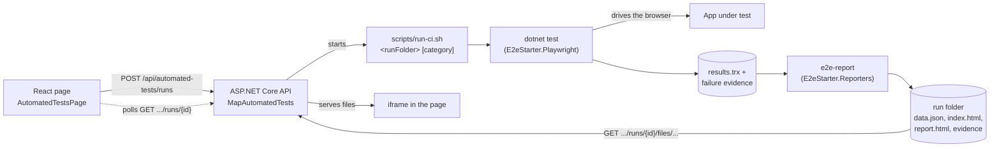

<div align="center">

# react-dotnet-playwright-e2e-starter

**A domain-agnostic starter for end-to-end testing a React app and an ASP.NET Core API with Playwright for .NET and xUnit v3, with a live dashboard you can open from your own React app and a shareable report for every run.**

[](https://github.com/perisicnikola37/react-dotnet-playwright-e2e-starter/actions/workflows/ci.yml)
[](https://github.com/perisicnikola37/react-dotnet-playwright-e2e-starter/actions/workflows/e2e.yml)
[](https://github.com/perisicnikola37/react-dotnet-playwright-e2e-starter/actions/workflows/codeql.yml)
[](https://github.com/perisicnikola37/react-dotnet-playwright-e2e-starter/actions/workflows/publish.yml)


[](LICENSE)

[Packages](#-packages) · [5-minute setup](#-add-it-to-your-react-project-in-5-minutes) · [How it works](#-how-it-works) · [Feeds](#access-to-the-feeds) · [Packages in detail](#1-test-project) · [Security](#-security-notes) · [Configuration](#configuration) · [Releasing](#-releasing) · [Contributing](#-contributing)


<sub>Preview with dummy data: <a href="https://perisicnikola37.github.io/react-dotnet-playwright-e2e-starter/">open the live demo</a> or build it yourself with <code>node packages/dashboard/demo/build.mjs --site _site</code>.</sub>

</div>

---

## 📦 Packages

| Package | Registry | Add it to | What it does |
|---|---|---|---|
| `E2eStarter.Playwright` | NuGet | the **test project** (xUnit v3) | settings loader, `SuiteFixture` and `UiTestBase` with isolated contexts, traces and failure evidence |
| `E2eStarter.Reporters` | NuGet (dotnet tool) | CI / the API host | `e2e-report`: turns a TRX plus failure evidence into `data.json`, `index.html` (live dashboard) and `report.html` (standalone) |
| `E2eStarter.AspNetCore` | NuGet | the **ASP.NET Core API** | `AddAutomatedTests` / `MapAutomatedTests`: endpoints that start a run, list runs and serve each run folder |
| `@perisicnikola37/e2e-starter-react` | npm | the **React frontend** | `AutomatedTestsPage` and `createAutomatedTestsClient`: start runs and view the live dashboard in an iframe |
| `@perisicnikola37/e2e-starter-dashboard` | npm | any CI / web host | `dashboard.html`: a single-file live dashboard and standalone report, plus the `data.json` contract |
| `@perisicnikola37/e2e-starter-client` | npm | the sample app only | typed client for the **sample** Items API (not needed for your own app) |

> [!NOTE]
> All packages live in GitHub Packages of `perisicnikola37` and are versioned together (tag `vX.Y.Z`). See the [live demo](https://perisicnikola37.github.io/react-dotnet-playwright-e2e-starter/) of the dashboard.

## ⚡ Add it to your React project in 5 minutes

Set up the [feeds](#access-to-the-feeds) first (a token with `read:packages`).

### 1) Test project

```bash
dotnet new xunit3 -n MyApp.E2E && cd MyApp.E2E
dotnet add package E2eStarter.Playwright
dotnet add package Microsoft.Testing.Extensions.TrxReport
```

Set `<OutputType>Exe</OutputType>`, use the Microsoft.Testing.Platform runner in `global.json`, and write tests as shown in [Test project](#1-test-project). Then copy [`scripts/run-ci.sh`](scripts/run-ci.sh) into your repo and point its `dotnet test --project` and `dotnet run --project` lines at your test project (or install the tool and call `e2e-report`, see [Reporter](#2-reporter)).

> [!IMPORTANT]
> `Microsoft.Testing.Extensions.TrxReport` is required: the reporter reads the TRX that `--report-trx` writes.

### 2) Backend

```bash
dotnet add package E2eStarter.AspNetCore
```

```csharp
builder.Services.AddAutomatedTests(o => o.Enabled = !builder.Environment.IsProduction());
// ...
app.MapAutomatedTests();                    // or app.MapAutomatedTests().RequireAuthorization();
```

Set `o.Command` (default `scripts/run-ci.sh`) and `o.WorkingDirectory` (default: the current directory) so the API can find the script, as the [sample API](src/E2eStarter.Api/Program.cs) does.

### 3) React

```bash
npm install @perisicnikola37/e2e-starter-react
```

With react-router:

```tsx
import { AutomatedTestsPage } from "@perisicnikola37/e2e-starter-react";

<Route path="/automated-tests" element={<AutomatedTestsPage categories={["Smoke", "Regression"]} />} />
```

The sample app has no router; it renders the page on a hash route in [`src/web/src/App.tsx`](src/web/src/App.tsx):

```tsx
const route = () => (location.hash === "#/automated-tests" ? "tests" : "items");
// ...
{current === "tests" ? <main className="wide"><AutomatedTestsPage /></main> : <ItemsPage />}
```

The page calls `/api/automated-tests` on the same origin; proxy it to the API in development (see `src/web/vite.config.ts`) or pass `baseUrl`.

### 4) Run it

Start the API and the web app, open `/automated-tests` (or `#/automated-tests` in the sample), pick a category and press the run button. The page polls the run and shows the dashboard of the selected run in an iframe.

## 🔄 How it works



1. The page starts a run; the API allows **one run at a time** (`409 Conflict` otherwise) and creates `{RunsDirectory}/{runId}/`.
2. The API calls `Command <runFolder> [category]`. `scripts/run-ci.sh` runs `dotnet test --report-trx` and then `e2e-report`.
3. Every test gets its own browser context and trace; failures save `screenshot.png`, `page.html`, `url.txt` and `trace.zip`.
4. The run folder holds `data.json`, `index.html` (live dashboard), `report.html` (standalone) and the evidence. The API serves it under `/runs/{id}/files/`, so the iframe shows totals, failures grouped by cause, new vs still failing tests, a timeline and per-test evidence.

## 🔒 Security notes

> [!WARNING]
> `AddAutomatedTests` runs a command on your server and drives a browser. Treat it as a test-environment feature.

- **Disabled by default and never in Production.** The endpoints are only mapped when `Enabled` is `true`; use `o.Enabled = !builder.Environment.IsProduction()`.
- **Authorization:** `app.MapAutomatedTests().RequireAuthorization()` protects every endpoint.
- **The iframe cannot send an `Authorization` header.** Use cookie authentication or serve the page and the API from the same origin.
- **Tests create and delete data.** Run them against test or staging environments only, never against real data.

## Access to the feeds

GitHub Packages needs a token with `read:packages` (CI: `GITHUB_TOKEN`; local: a classic PAT), even for public repositories.

<details>
<summary><b>NuGet.config</b> (next to your solution)</summary>

```xml
<configuration>
  <packageSources>
    <add key="perisicnikola37" value="https://nuget.pkg.github.com/perisicnikola37/index.json" />
  </packageSources>
  <packageSourceCredentials>
    <perisicnikola37>
      <add key="Username" value="YOUR_GITHUB_USER" />
      <add key="ClearTextPassword" value="%GITHUB_PACKAGES_TOKEN%" />
    </perisicnikola37>
  </packageSourceCredentials>
</configuration>
```

</details>

<details>
<summary><b>.npmrc</b> (next to your <code>package.json</code>)</summary>

```
@perisicnikola37:registry=https://npm.pkg.github.com
//npm.pkg.github.com/:_authToken=${GITHUB_PACKAGES_TOKEN}
```

</details>

> [!WARNING]
> Never commit a literal token. Read it from an environment variable, as above.

## 1. Test project

`E2eStarter.Playwright`

```
dotnet add package E2eStarter.Playwright
```

> [!IMPORTANT]
> Requires **xUnit v3** on the **Microsoft.Testing.Platform** runner (`global.json`: `"test": { "runner": "Microsoft.Testing.Platform" }`), and `<OutputType>Exe</OutputType>` in the test project.

```csharp
[CollectionDefinition(UiTestBase.CollectionName)]
public sealed class BrowserCollection : ICollectionFixture<SuiteFixture>;

[Trait(TestCategories.Key, TestCategories.Smoke)]
public sealed class AppLoadsTests(SuiteFixture suite) : UiTestBase(suite)
{
    [Fact]
    public async Task The_items_page_loads_with_its_heading()
    {
        var items = await new ItemsPage(Page).OpenAsync();
        (await items.HeadingTextAsync()).ShouldBe("Items");
    }
}
```

> [!TIP]
> Page objects own the locators; tests contain intent and assertions only. Prefer role / label, then `data-testid`, then CSS.

<details>
<summary><b>Contract: what a failed test leaves behind</b></summary>

| File | Written by | Notes |
|---|---|---|
| `screenshot.png` | `UiTestBase` | full page, taken on failure |
| `page.html` | `UiTestBase` | captured DOM |
| `url.txt` | `UiTestBase` | URL at the time of failure |
| `trace.zip` | `UiTestBase` | Playwright trace (`Artifacts:Trace`); open with `playwright show-trace` |

</details>

## 2. Reporter

`E2eStarter.Reporters` (dotnet tool `e2e-report`)

```bash
dotnet tool install E2eStarter.Reporters --global
dotnet test --report-trx --report-trx-filename results.trx --results-directory out
e2e-report --trx out/results.trx --artifacts out/artifacts/evidence --out out --title "My app" --env staging
```

> [!IMPORTANT]
> The test project needs `Microsoft.Testing.Extensions.TrxReport` for `--report-trx`.

| Flag | Default | Meaning |
|---|---|---|
| `--trx <file>` | required | TRX written by `dotnet test` |
| `--out <dir>` | required | run folder; receives `data.json`, `index.html` (live dashboard) and `report.html` (standalone) |
| `--artifacts <dir>` | none | failure evidence written by `E2eStarter.Playwright` |
| `--previous <file>` | none | `data.json` of the previous run (new failure / still failing) |
| `--title <text>` | `UI tests` | dashboard title |
| `--run-id <id>` | current UTC time | run identifier |
| `--env <name>` | `local` | environment label |
| `--base-url <url>` | `http://localhost:5180` | app under test |

## 3. API

`E2eStarter.AspNetCore`

```bash
dotnet add package E2eStarter.AspNetCore
```

```csharp
builder.Services.AddAutomatedTests(o =>
{
    o.Enabled = !builder.Environment.IsProduction();
    o.Command = "scripts/run-ci.sh";
    o.Environment["AUTOMATED_TESTS_ENV"] = builder.Environment.EnvironmentName;
});
app.MapAutomatedTests().RequireAuthorization();
```

| Method | Path | Result |
|---|---|---|
| `POST` | `/api/automated-tests/runs` | start a run (`{ "category": "Smoke" }`); `202`, or `409` while another run is in progress |
| `GET` | `/api/automated-tests/runs` | all runs |
| `GET` | `/api/automated-tests/runs/{id}` | one run (status, counts, exit code) |
| `GET` | `/api/automated-tests/runs/{id}/log` | runner output |
| `GET` | `/api/automated-tests/runs/{id}/files/{path}` | files of the run folder (`index.html`, `data.json`, evidence) |

| Option | Default | Meaning |
|---|---|---|
| `Enabled` | `false` | nothing is mapped unless `true`; never enable in Production |
| `RunsDirectory` | `artifacts/runs` | run folders are created as `{RunsDirectory}/{runId}/` |
| `Command` | `scripts/run-ci.sh` | started as `Command <runFolder> [category]`; must write `data.json` and `index.html` there |
| `WorkingDirectory` | current directory | working directory of the command |
| `Timeout` | 15 minutes | maximum duration of a run |
| `Environment` | empty | extra environment variables for the command |

`scripts/run-ci.sh` is the command the sample API calls: it runs the E2E tests with a TRX report and then `e2e-report`. Run it by hand against a running app with `scripts/run-ci.sh out/run1 Smoke`. It reads `AUTOMATED_TESTS_TITLE`, `AUTOMATED_TESTS_ENV`, `E2E_BaseUrl` and `E2E_PREVIOUS_DATA` (path to the previous `data.json`).

## 4. React page

`@perisicnikola37/e2e-starter-react`

```bash
npm install @perisicnikola37/e2e-starter-react
```

```tsx
import { AutomatedTestsPage, createAutomatedTestsClient } from "@perisicnikola37/e2e-starter-react";

<AutomatedTestsPage categories={["Smoke", "Regression"]} />

// custom origin or authentication:
const client = createAutomatedTestsClient({ baseUrl: "https://api.example.test" });
<AutomatedTestsPage client={client} />
```

React 18+ is a peer dependency. `AutomatedTestsPage` also accepts `pollMs` (default 2000).

## 5. Dashboard

`@perisicnikola37/e2e-starter-dashboard`

```
npm install @perisicnikola37/e2e-starter-dashboard
```

The package ships one self-contained file, `dist/dashboard.html`. The reporter writes it for you as `index.html`; to do it by hand, put it next to your run data as `index.html`, or embed the data for a standalone report by replacing `<script id="report-data" type="application/json">null</script>` with the run as JSON.

<details>
<summary><b>Contract: <code>data.json</code></b></summary>

```jsonc
{
  "title": "My app · UI tests",
  "runId": "20261023143248",
  "previousRunId": "20261010090000",     // optional: enables "new failure" / "still failing"
  "environment": "staging",
  "baseUrl": "https://staging.example.test",
  "startedAt": "2026-10-23T14:32:48Z",
  "elapsedMs": 13000,
  "tests": [{
    "name": "My.Namespace.ItemsTests.Blank_name_is_rejected",
    "categories": ["Smoke"],
    "status": "failed",                  // passed | failed | skipped
    "previous": "passed",                // status in the previous run
    "durationMs": 3200,
    "error": "…", "stack": "…", "url": "…",
    "steps": ["Open /items", "Click 'Add item'"], "failedStep": 1,
    "console": ["[error] …"], "screenshot": "evidence/blank-name.png",
    "pageHtml": "evidence/blank-name.html",   // optional: captured DOM
    "trace": "evidence/blank-name.zip"        // optional: Playwright trace
  }]
}
```

</details>

Keyboard: `/` search · `j` / `k` step through failures.

## 6. Sample API client

`@perisicnikola37/e2e-starter-client`

> [!NOTE]
> This client is specific to the sample Items API. You do not need it for your own app.

```
npm install @perisicnikola37/e2e-starter-client
```

```tsx
import { createItemsClient } from "@perisicnikola37/e2e-starter-client";

const client = createItemsClient();           // same origin; pass { baseUrl } otherwise
const items = await client.list();
await client.create("Review the test plan");
```

## Quick start

Requirements: .NET 10 SDK, Node.js 22+, PowerShell (`pwsh`) for the browser install.

```bash
npm ci
dotnet build E2eStarter.sln
pwsh tests/E2eStarter.E2E/bin/Debug/net10.0/playwright.ps1 install chromium
scripts/run-e2e.sh                      # full local cycle: start API + web, run all tests, clean up
scripts/run-e2e.sh --browser chrome     # use the system Chrome
dotnet test --project tests/E2eStarter.E2E --filter-trait "Category=Smoke"
dotnet test --project tests/E2eStarter.Api.Tests
```

The script refuses to start if ports `5080` / `5180` are already in use.

## Configuration

Settings come from `appsettings.json`, overridable with `E2E_`-prefixed environment variables (`__` as the separator).

| Variable | Default | Meaning |
|---|---|---|
| `E2E_BaseUrl` | `http://localhost:5180` | web app under test |
| `E2E_ApiBaseUrl` | `http://localhost:5080` | API used for data setup |
| `E2E_Browser__Name` | `chromium` | `chromium`, `chrome`, `firefox`, `webkit` |

## Project structure

```text
src/
  E2eStarter.Api/          sample minimal API (in-memory items, /health, automated tests endpoints)
  E2eStarter.Playwright/   reusable test infrastructure (NuGet)
  E2eStarter.Reporters/    e2e-report dotnet tool: TRX to dashboard (NuGet)
  E2eStarter.AspNetCore/   AddAutomatedTests / MapAutomatedTests (NuGet)
  web/                     sample React + Vite app (Items + Automated tests pages)
packages/
  api-client/              typed client of the sample Items API (npm)
  dashboard/               dashboard.html + demo builder (npm)
  react/                   AutomatedTestsPage + client (npm)
tests/
  E2eStarter.E2E/          page objects + Smoke/Regression tests
  E2eStarter.Api.Tests/    API integration tests
scripts/run-ci.sh          run tests with TRX, then e2e-report (called by the API)
scripts/run-e2e.sh         full local cycle: start apps, run tests, clean up
.github/workflows/         ci, e2e, codeql, commitlint, publish, pages
```

## 🚀 Releasing

1. Bump `<Version>` in `Directory.Build.props` and `version` in every `packages/*/package.json` (they must match).
2. Update `CHANGELOG.md`, merge, then push the tag: `git tag vX.Y.Z && git push origin vX.Y.Z`.

The **Publish** workflow verifies that the tag matches every version, publishes the NuGet and npm packages and creates the GitHub Release. The **Pages** workflow redeploys the demo to GitHub Pages on every change to the dashboard.

## 🤝 Contributing

See [CONTRIBUTING.md](CONTRIBUTING.md), [CODE_OF_CONDUCT.md](CODE_OF_CONDUCT.md) and [SECURITY.md](SECURITY.md). Commits and PR titles follow Conventional Commits; pull requests are squash-merged.

## License

[MIT](LICENSE)
