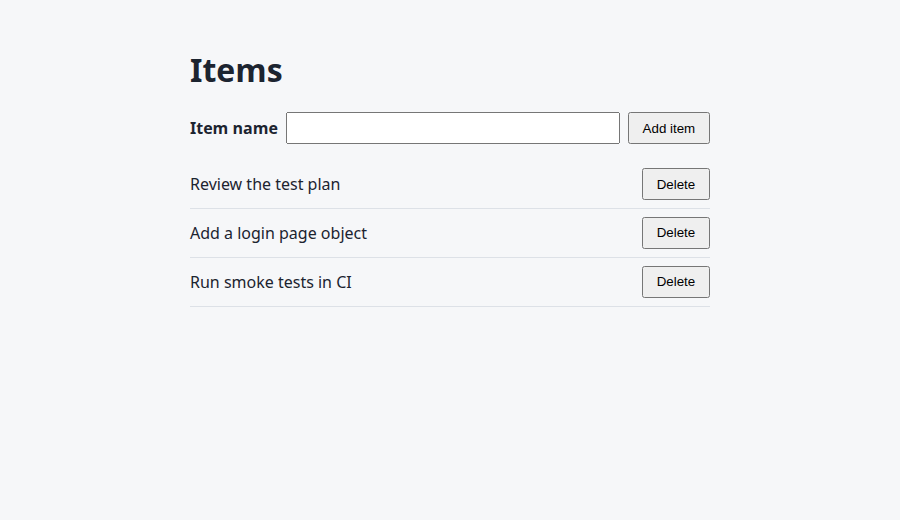
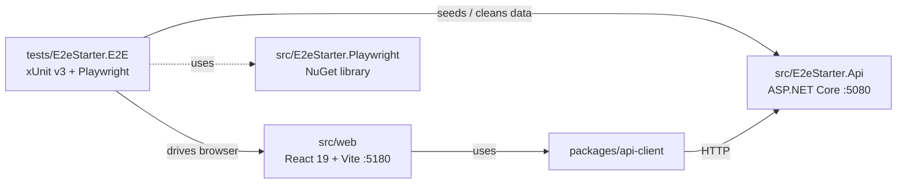

<div align="center">

# React + .NET + Playwright E2E Starter

**A production-ready, domain-agnostic starter for end-to-end testing a React app and an ASP.NET Core API with Playwright for .NET and xUnit v3.**

[](https://github.com/perisicnikola37/react-dotnet-playwright-e2e-starter/actions/workflows/ci.yml)
[](https://github.com/perisicnikola37/react-dotnet-playwright-e2e-starter/actions/workflows/e2e.yml)
[](https://github.com/perisicnikola37/react-dotnet-playwright-e2e-starter/actions/workflows/codeql.yml)
[](LICENSE)



</div>

## Contents

- [Why](#why)
- [Packages](#packages)
- [Architecture](#architecture)
- [Quick start](#quick-start)
- [Installing the packages](#installing-the-packages)
- [Configuration](#configuration)
- [Project structure](#project-structure)
- [Releasing](#releasing)
- [Contributing](#contributing)
- [License](#license)

## Why

- **Page objects + isolated tests**: every test gets its own browser context, with a trace.
- **Failure evidence**: screenshot, `page.html`, URL and `trace.zip` are saved when a test fails.
- **Categories**: `Smoke` and `Regression`, filterable from the CLI and CI.
- **Self-contained data**: tests create and remove their data through the API.
- **One command**: `scripts/run-e2e.sh` starts the API and the web app, runs the tests and cleans up.
- **Reusable infrastructure** published as a NuGet package, plus a typed npm API client.

## Packages

| Package | Registry | Description |
| --- | --- | --- |
| `E2eStarter.Playwright` | NuGet (GitHub Packages) | Settings loader, suite fixture and base test class for Playwright .NET + xUnit v3 |
| `@perisicnikola37/e2e-starter-client` | npm (GitHub Packages) | Typed client for the sample Items API |

## Architecture



## Quick start

Requirements: .NET 10 SDK, Node.js 22+, PowerShell (`pwsh`) for the browser install.

```bash
npm ci
dotnet build E2eStarter.sln
pwsh tests/E2eStarter.E2E/bin/Debug/net10.0/playwright.ps1 install chromium
scripts/run-e2e.sh                      # all tests
scripts/run-e2e.sh --browser chrome     # use the system Chrome
dotnet test --project tests/E2eStarter.E2E --filter-trait "Category=Smoke"
dotnet test --project tests/E2eStarter.Api.Tests
```

The script refuses to start if ports `5080` / `5180` are already in use.

## Installing the packages

GitHub Packages requires a token with `read:packages`, even for public repositories.

**npm** (`.npmrc`):

```ini
@perisicnikola37:registry=https://npm.pkg.github.com
//npm.pkg.github.com/:_authToken=${GITHUB_TOKEN}
```

```bash
npm install @perisicnikola37/e2e-starter-client
```

**NuGet** (`NuGet.config`):

```xml
<configuration>
  <packageSources>
    <add key="github" value="https://nuget.pkg.github.com/perisicnikola37/index.json" />
  </packageSources>
</configuration>
```

```bash
dotnet nuget update source github --username <user> --password <token> --store-password-in-clear-text
dotnet add package E2eStarter.Playwright
```

## Configuration

Settings come from `appsettings.json`, overridable with `E2E_`-prefixed environment variables (`__` as the separator).

| Variable | Default | Meaning |
| --- | --- | --- |
| `E2E_BaseUrl` | `http://localhost:5180` | Web app under test |
| `E2E_ApiBaseUrl` | `http://localhost:5080` | API used for data setup |
| `E2E_Browser__Name` | `chromium` | `chromium`, `chrome`, `firefox`, `webkit` |

## Project structure

```text
src/
  E2eStarter.Api/          sample minimal API (in-memory items + /health)
  E2eStarter.Playwright/   reusable test infrastructure (NuGet)
  web/                     sample React + Vite app
packages/api-client/       typed npm client
tests/
  E2eStarter.E2E/          page objects + Smoke/Regression tests
  E2eStarter.Api.Tests/    API integration tests
scripts/run-e2e.sh         start apps, run tests, clean up
.github/workflows/         ci, e2e, codeql, commitlint, publish
```

## Releasing

Bump the version in `Directory.Build.props` and `packages/api-client/package.json`, update `CHANGELOG.md`, then push a tag `vX.Y.Z`. The **Publish** workflow verifies the versions, publishes both packages and creates the GitHub Release.

## Contributing

See [CONTRIBUTING.md](CONTRIBUTING.md), [CODE_OF_CONDUCT.md](CODE_OF_CONDUCT.md) and [SECURITY.md](SECURITY.md). Commits follow Conventional Commits.

## License

[MIT](LICENSE)
