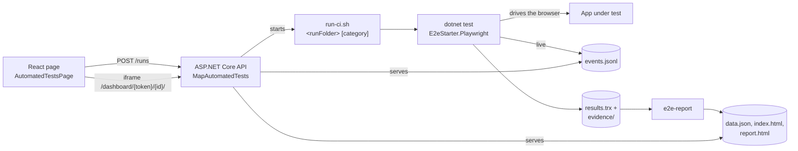

<div align="center">

# Playwright test dashboard for React apps

### react-dotnet-playwright-e2e-starter

**Add a Playwright UI test dashboard to your React app. Start Playwright for .NET tests from a page in your app, watch every test pass or fail live, re-run the failures with one click and share an HTML report with screenshots, steps, console output and traces.**

ASP.NET Core · React · Playwright for .NET · xUnit v3 · GitHub Actions

[](https://github.com/perisicnikola37/react-dotnet-playwright-e2e-starter/actions/workflows/ci.yml)
[](https://github.com/perisicnikola37/react-dotnet-playwright-e2e-starter/actions/workflows/e2e.yml)
[](https://github.com/perisicnikola37/react-dotnet-playwright-e2e-starter/actions/workflows/codeql.yml)
[](https://github.com/perisicnikola37/react-dotnet-playwright-e2e-starter/actions/workflows/publish.yml)


[](LICENSE)

[**Live demo**](https://perisicnikola37.github.io/react-dotnet-playwright-e2e-starter/demo/) · [Website](https://perisicnikola37.github.io/react-dotnet-playwright-e2e-starter/) · [Add it to your app](#-add-it-to-your-react-app) · [How it works](#-how-it-works) · [Security](#-security) · [FAQ](#-faq)


<sub>The dashboard with dummy data. <a href="https://perisicnikola37.github.io/react-dotnet-playwright-e2e-starter/demo/">Open the live demo</a> or build it with <code>node packages/dashboard/demo/build.mjs --site _site</code>.</sub>

</div>

---

## ✨ What you get

- **▶ Start UI tests from the browser.** A React page in your app runs all Playwright tests or one category (Smoke, Regression). One run at a time, with a timeout.
- **⏱ Live progress.** Every test shows as queued, running, passed or failed while the run is still going.
- **🔁 Re-run failed tests** (or all, or the same selection) with one click.
- **📸 Failure evidence.** Screenshot, page HTML, URL, browser console, named steps and the Playwright trace for every failed test.
- **🆚 Compared with the previous run.** New failures and tests that are still failing are marked.
- **📄 Shareable HTML report.** Every run writes a standalone `report.html` for CI artifacts, tickets or email.
- **🔒 Safe by default.** Not mapped in Production unless you opt in, works with your authorization, short-lived iframe tokens, sandboxed evidence files.
- **🧱 Production-ready test setup.** Page objects, one browser per run, an isolated context and trace per test, layered `E2E_*` configuration, CI workflows.

Use it two ways: **add the packages to an existing React + ASP.NET Core app**, or **[start from this template](https://github.com/perisicnikola37/react-dotnet-playwright-e2e-starter/generate)** with a sample app and tests that already work.

## 📦 Packages

| Package | Add it to | What it does |
|---|---|---|
| [`E2eStarter.Playwright`](src/E2eStarter.Playwright) | your **UI test project** (NuGet) | `SuiteFixture` and `UiTestBase`: browser per run, context and trace per test, failure evidence, `Step()`, live progress events |
| [`E2eStarter.AspNetCore`](src/E2eStarter.AspNetCore) | your **ASP.NET Core API** (NuGet) | `AddAutomatedTests()` / `MapAutomatedTests()`: start, list and re-run runs; serve the dashboard and evidence |
| [`E2eStarter.Reporters`](src/E2eStarter.Reporters) | CI or the API host (dotnet tool) | `e2e-report`: TRX + evidence to `data.json`, `index.html` (dashboard) and `report.html` (standalone) |
| [`@perisicnikola37/e2e-starter-react`](packages/react) | your **React app** (npm) | `<AutomatedTestsPage />` and `createAutomatedTestsClient()` |
| [`@perisicnikola37/e2e-starter-dashboard`](packages/dashboard) | any web host (npm) | `dashboard.html`: the single-file dashboard and report, plus the `data.json` contract |

> [!NOTE]
> The packages are published to [nuget.org](https://www.nuget.org/profiles/perisicnikola37) and [npmjs.com](https://www.npmjs.com/~perisicnikola37) and versioned together (tag `vX.Y.Z`). No tokens or extra feeds are needed to install them.

## ⚡ Add it to your React app

Requirements: .NET 10 SDK, Node.js 22+, a React 18+ app with an ASP.NET Core backend.

### 1) Test project

```bash
dotnet new xunit3 -n MyApp.E2E && cd MyApp.E2E
dotnet add package E2eStarter.Playwright
dotnet add package Microsoft.Testing.Extensions.TrxReport
```

Use the Microsoft.Testing.Platform runner (`global.json`: `"test": { "runner": "Microsoft.Testing.Platform" }`) and `<OutputType>Exe</OutputType>`. Then:

```csharp
// Once per test project: a shared browser and live progress for the dashboard.
[assembly: TestFramework(typeof(LiveProgressTestFramework))]

[CollectionDefinition(UiTestBase.CollectionName)]
public sealed class BrowserCollection : ICollectionFixture<SuiteFixture>;

[Trait(TestCategories.Key, TestCategories.Smoke)]
public sealed class ItemsTests(SuiteFixture suite) : UiTestBase(suite)
{
    [Fact]
    public async Task Adds_an_item()
    {
        Step("Open the items page");
        var items = await new ItemsPage(Page).OpenAsync();

        Step("Add an item");
        await items.AddItemAsync("Review the test plan");

        Step("Check the list");
        (await items.ItemNamesAsync()).ShouldContain("Review the test plan");
    }
}
```

Copy [`scripts/run-ci.sh`](scripts/run-ci.sh) into your repository and point its `dotnet test --project` and `dotnet run --project` lines at your test project and the reporter (or install the `e2e-report` tool, see [Reporter](#reporter)).

### 2) Backend

```bash
dotnet add package E2eStarter.AspNetCore
```

```csharp
builder.Services.AddAutomatedTests(builder.Configuration.GetSection("AutomatedTests"));
// ...
app.MapAutomatedTests().RequireAuthorization();   // /api/automated-tests
```

```json
"AutomatedTests": { "WorkingDirectory": "../..", "Title": "My app · UI tests" }
```

`WorkingDirectory` is where the API finds `Command` (default `scripts/run-ci.sh`). See the [sample API](src/E2eStarter.Api/Program.cs).

### 3) React

```bash
npm install @perisicnikola37/e2e-starter-react
```

```tsx
import { AutomatedTestsPage } from "@perisicnikola37/e2e-starter-react";

<Route path="/automated-tests" element={<AutomatedTestsPage categories={["Smoke", "Regression"]} />} />
```

The page calls `/api/automated-tests` on the same origin; proxy it in development (see [`src/web/vite.config.ts`](src/web/vite.config.ts)) or pass a client with `baseUrl`. With bearer tokens (MSAL, Auth0, ...):

```tsx
const client = createAutomatedTestsClient({ baseUrl: "https://api.example.test", getAccessToken: () => acquireToken() });
<AutomatedTestsPage client={client} title="UI tests" />
```

### 4) Run it

Start the API and the web app, open `/automated-tests`, pick a category and press **Run**. The dashboard of the run appears below and updates live; when the run finishes you can re-run the failed tests from it.

### Or let an AI assistant do it

Open your app in an AI coding assistant (GitHub Copilot, Claude Code, Cursor, ...) and paste this prompt:

```text
Add the Playwright UI test dashboard from
https://github.com/perisicnikola37/react-dotnet-playwright-e2e-starter
to this repository. Read its README section "Add it to your React app" and
follow it step by step. Requirements: .NET 10 SDK, Node.js 22+, React 18+ with an
ASP.NET Core backend. Check them first and tell me what is missing.

1. The packages are public on nuget.org and npmjs.com: no feeds, tokens or
   .npmrc / NuGet.config changes are needed.
2. Test project: `dotnet new xunit3 -n <App>.E2E`, add E2eStarter.Playwright and
   Microsoft.Testing.Extensions.TrxReport, use the Microsoft.Testing.Platform runner
   (global.json), <OutputType>Exe</OutputType>, the TestFramework assembly attribute,
   the BrowserCollection, and one Smoke test with a page object for a real page of
   this app. Copy scripts/run-ci.sh and point it at the new test project.
3. Backend: add E2eStarter.AspNetCore, call AddAutomatedTests(...) and
   MapAutomatedTests().RequireAuthorization(), and add the "AutomatedTests" config
   section (WorkingDirectory, Title).
4. React: `npm install @perisicnikola37/e2e-starter-react`, add a route
   /automated-tests rendering <AutomatedTestsPage categories={["Smoke","Regression"]} />,
   and proxy /api/automated-tests in development. If the app uses bearer tokens, pass
   a client from createAutomatedTestsClient({ getAccessToken }).
5. Verify: build the backend and frontend, start both, open /automated-tests and run
   the Smoke category.

Use existing code style and auth. Do not enable AllowInProduction. If a step
fails, show me the error and suggest a fix before continuing.
```

## 🔄 How it works



1. The page starts a run. The API allows **one run at a time** (`409 Conflict` otherwise) and creates `{RunsDirectory}/{runId}/`.
2. The API calls `Command <runFolder> [category]` (and passes a filter file for re-runs). `run-ci.sh` runs `dotnet test --report-trx`, then `e2e-report`.
3. While tests run, `LiveProgressTestFramework` appends to `events.jsonl`; the dashboard polls it and shows progress.
4. Every test gets its own browser context and trace. A failed test leaves `screenshot.png`, `page.html`, `url.txt`, `console.json`, `steps.json` and `trace.zip` in `evidence/<test>/`.
5. The reporter writes `data.json`, `index.html` and the standalone `report.html`; the dashboard switches from live mode to the final report.
6. The page shows the dashboard in an iframe through a short-lived token (an iframe cannot send an `Authorization` header).

## 🔒 Security

> [!WARNING]
> `AddAutomatedTests` runs a command on your server that drives a browser against your app. Treat it as a test-environment feature.

- **Not in Production.** Nothing is mapped in the `Production` environment unless `AllowInProduction` is `true`. `Enabled: false` turns the endpoints off anywhere.
- **Authorization.** `app.MapAutomatedTests().RequireAuthorization()` protects the API. The dashboard routes are anonymous on purpose: they need a random token from `POST /dashboard-token`, which only an authorized caller gets, and which expires (`DashboardTokenLifetime`, 2 hours).
- **Sandboxed files.** The dashboard is served with a strict Content-Security-Policy; screenshots, page HTML and traces are served with `Content-Security-Policy: sandbox`, `nosniff` and `no-store`. Paths outside the run folder are rejected.
- **CSRF.** Re-run from the dashboard requires an `X-Requested-With: e2e-dashboard` header.
- **Tests change data.** Point them at test or staging environments only.

## 📚 Packages in detail

### Test project

`E2eStarter.Playwright` requires **xUnit v3** on the **Microsoft.Testing.Platform** runner.

- `SuiteFixture` starts one browser per run; `UiTestBase` gives each test a new context, `Page`, trace and failure evidence.
- `Step("...")` names the current step; the dashboard shows the steps and the one that failed.
- `[assembly: TestFramework(typeof(LiveProgressTestFramework))]` writes live events when `E2E_LiveEventsPath` is set (`run-ci.sh` sets it).
- Page objects own the locators; tests contain intent and assertions only. Prefer role / label, then `data-testid`, then CSS.

| Evidence file | Content |
|---|---|
| `screenshot.png` | full page at the time of failure |
| `page.html` | captured DOM |
| `url.txt` | URL at the time of failure |
| `console.json` | browser console errors and warnings, page errors |
| `steps.json` | steps from `Step()` |
| `trace.zip` | Playwright trace (`Artifacts:Trace`); open with `playwright show-trace` or [trace.playwright.dev](https://trace.playwright.dev) |

### Reporter

`E2eStarter.Reporters`, dotnet tool `e2e-report`:

```bash
dotnet tool install E2eStarter.Reporters --global
dotnet test --report-trx --report-trx-filename results.trx --results-directory out
e2e-report --trx out/results.trx --artifacts out/evidence --out out --title "My app" --env staging
```

| Flag | Default | Meaning |
|---|---|---|
| `--trx <file>` | required | TRX written by `dotnet test` (needs `Microsoft.Testing.Extensions.TrxReport`) |
| `--out <dir>` | required | receives `data.json`, `index.html` and `report.html` |
| `--artifacts <dir>` | none | failure evidence written by `E2eStarter.Playwright` |
| `--previous <file>` | none | `data.json` of the previous run (new failure / still failing) |
| `--title <text>` | `UI tests` | dashboard title |
| `--run-id <id>` | current UTC time | run identifier |
| `--env <name>` | `local` | environment label |
| `--base-url <url>` | `http://localhost:5180` | app under test |

### API

`E2eStarter.AspNetCore`, below the prefix (default `/api/automated-tests`):

| Method | Path | Result |
|---|---|---|
| `POST` | `/runs` | start a run (`{ "category": "Smoke" }` or `{ "tests": ["Full.Test.Name"] }`); `202`, or `409` while a run is in progress |
| `GET` | `/runs` | recent runs, newest first |
| `GET` | `/runs/{id}` | one run: status, counts, exit code |
| `POST` | `/runs/{id}/rerun` | `{ "mode": "all" \| "failed" \| "same" }` |
| `GET` | `/runs/{id}/log` | runner output |
| `POST` | `/dashboard-token` | `{ token, expiresAt }` for the iframe |
| `GET` | `/dashboard/{token}/{id}/{path}` | dashboard and files of the run (anonymous, token-checked) |

| Option | Default | Meaning |
|---|---|---|
| `Enabled` | `true` | `false` maps nothing |
| `AllowInProduction` | `false` | map the endpoints in the `Production` environment too |
| `RunsDirectory` | `artifacts/runs` | run folders are `{RunsDirectory}/{runId}/` |
| `Command` | `scripts/run-ci.sh` | started as `Command <runFolder> [category]` |
| `WorkingDirectory` | current directory | working directory of the command |
| `Timeout` | 15 minutes | maximum duration of a run |
| `Title` | `UI tests` | dashboard title (passed as `E2E_Title`) |
| `MaxRuns` | `20` | older run folders are deleted |
| `DashboardTokenLifetime` | 2 hours | lifetime of iframe tokens |
| `Environment` | empty | extra environment variables for the command |

`run-ci.sh` also works by hand against a running app: `scripts/run-ci.sh out/run1 Smoke`. It reads `E2E_BaseUrl`, `E2E_Title`, `E2E_ENVIRONMENT`, `E2E_PREVIOUS_DATA` (previous `data.json`) and `AUTOMATED_TESTS_FILTER_FILE` (one test per line).

### React page

`@perisicnikola37/e2e-starter-react` (React 18+):

| Prop | Default | Meaning |
|---|---|---|
| `client` | created from `baseUrl` | a client from `createAutomatedTestsClient()` |
| `baseUrl` | same origin | API origin |
| `title` | `Automated tests` | page heading |
| `categories` | `["Smoke", "Regression"]` | a **Run** button per category, next to **Run all** |
| `pollMs` | `3000` | run list refresh while a run is in progress |
| `height` | `80vh` | dashboard iframe height |

`createAutomatedTestsClient({ baseUrl, prefix, fetch, getAccessToken })` returns `listRuns`, `getRun`, `startRun`, `rerun`, `issueDashboardToken`, `dashboardUrl` and `logUrl`.

### Dashboard

`@perisicnikola37/e2e-starter-dashboard` ships one self-contained file, `dist/dashboard.html`. It reads, in order: data embedded in `<script id="report-data">`, `data.json`, then `events.jsonl` (live). The reporter writes it for you; you can also host it next to any `data.json`.

<details>
<summary><b>Contract: <code>data.json</code></b></summary>

```jsonc
{
  "title": "My app · UI tests",
  "runId": "20261023143248000",
  "previousRunId": "20261010090000000",  // optional: enables "new failure" / "still failing"
  "environment": "staging",
  "baseUrl": "https://staging.example.test",
  "startedAt": "2026-10-23T14:32:48Z",
  "elapsedMs": 13000,
  "tests": [{
    "name": "My.Namespace.ItemsTests.Blank_name_is_rejected",
    "categories": ["Smoke"],
    "status": "failed",                  // passed | failed | skipped
    "previous": "passed",
    "durationMs": 3200,
    "error": "…", "stack": "…", "url": "…",
    "steps": ["Open /items", "Click 'Add item'"], "failedStep": 1,
    "console": ["[error] …"],
    "screenshot": "evidence/My.Namespace.ItemsTests.Blank_name_is_rejected/screenshot.png",
    "pageHtml": "evidence/…/page.html",
    "trace": "evidence/…/trace.zip"
  }]
}
```

</details>

Keyboard: `/` search · `j` / `k` step through failures.

## 🚀 Run the starter locally

Requirements: .NET 10 SDK, Node.js 22+, PowerShell (`pwsh`) for the browser install.

```bash
npm ci
dotnet build E2eStarter.sln
pwsh tests/E2eStarter.E2E/bin/Debug/net10.0/playwright.ps1 install chromium
scripts/run-e2e.sh                      # start API + web, run all UI tests, clean up
scripts/run-e2e.sh --browser chrome     # use the system Chrome
scripts/run-e2e.sh --report out/report  # also write the dashboard and report.html to out/report
dotnet test --project tests/E2eStarter.E2E --filter-trait "Category=Smoke"
```

Or start the API (`dotnet run --project src/E2eStarter.Api`, port 5080) and the web app (`npm run dev --workspace src/web`, port 5180) and open <http://localhost:5180/#/automated-tests>.

Unit and integration tests: `dotnet test --project tests/E2eStarter.Api.Tests`, `tests/E2eStarter.AspNetCore.Tests`, `tests/E2eStarter.Reporters.Tests`, and `npm test --workspace packages/react`.

### Configuration

Test settings come from `appsettings.json`, overridable with `E2E_`-prefixed environment variables (`__` as the separator).

| Variable | Default | Meaning |
|---|---|---|
| `E2E_BaseUrl` | `http://localhost:5180` | web app under test |
| `E2E_ApiBaseUrl` | `http://localhost:5080` | API used for data setup |
| `E2E_Browser__Name` | `chromium` | `chromium`, `chrome`, `firefox`, `webkit` |
| `E2E_Browser__Headless` | `true` | show the browser with `false` |
| `E2E_Artifacts__Trace` | `true` | record a Playwright trace per test |
| `E2E_LiveEventsPath` | none | where live progress is written (set by `run-ci.sh`) |

### Project structure

```text
src/
  E2eStarter.Api/          sample minimal API (in-memory items, /health, automated tests endpoints)
  E2eStarter.Playwright/   test infrastructure (NuGet)
  E2eStarter.Reporters/    e2e-report dotnet tool (NuGet)
  E2eStarter.AspNetCore/   AddAutomatedTests / MapAutomatedTests (NuGet)
  web/                     sample React + Vite app (Items + Automated tests pages)
packages/
  dashboard/               dashboard.html + demo builder (npm)
  react/                   AutomatedTestsPage + client (npm)
tests/
  E2eStarter.E2E/          page objects, Smoke/Regression tests, dashboard tests
  E2eStarter.Api.Tests/    sample API integration tests
  E2eStarter.AspNetCore.Tests/  endpoint, token and re-run tests
  E2eStarter.Reporters.Tests/   report builder tests
site/                      landing page on GitHub Pages
scripts/run-ci.sh          run tests with TRX, then e2e-report (called by the API)
scripts/run-e2e.sh         full local cycle: start apps, run tests, clean up
.github/workflows/         ci, e2e, codeql, commitlint, publish, pages
```

## ❓ FAQ

<details>
<summary><b>How do I add a Playwright test dashboard to my React app?</b></summary>

Add `E2eStarter.AspNetCore` to your ASP.NET Core API (`AddAutomatedTests()` + `MapAutomatedTests()`) and render `<AutomatedTestsPage />` from `@perisicnikola37/e2e-starter-react` on any route. See [Add it to your React app](#-add-it-to-your-react-app).

</details>

<details>
<summary><b>Does it work with Playwright for Node.js (<code>@playwright/test</code>)?</b></summary>

The test infrastructure and reporter are built for Playwright for .NET with xUnit v3. The React page and the dashboard only need the HTTP endpoints and the `data.json` / `events.jsonl` contracts, so another runner can write them, but the starter ships the .NET pieces.

</details>

<details>
<summary><b>My backend is not ASP.NET Core. Can I still use it?</b></summary>

Yes, with more work: run the tests and `e2e-report` from CI (or any script) and host `report.html`, or implement the endpoints listed under [API](#api) in your backend.

</details>

<details>
<summary><b>Can I share a report without the app running?</b></summary>

Yes. Every run writes a standalone `report.html` with the data embedded. The E2E workflow in this repository uploads it, with the dashboard and evidence, as the `e2e-report` artifact.

</details>

<details>
<summary><b>Can testers run tests in a deployed test environment?</b></summary>

Yes. Deploy the API with the test project and `run-ci.sh` next to it, set `E2E_BaseUrl` through `AutomatedTests:Environment`, and protect the endpoints with `RequireAuthorization()`. In `Production` the endpoints are not mapped unless you set `AllowInProduction`.

</details>

<details>
<summary><b>How do I re-run only the failed tests?</b></summary>

Press **Failed only** in the dashboard's re-run panel. In a static report the same button copies a `dotnet test --filter-method ...` command instead.

</details>

## 🚢 Releasing

1. Bump `<Version>` in `Directory.Build.props` and `version` in every `packages/*/package.json` (they must match).
2. Update `CHANGELOG.md`, merge, then push the tag: `git tag vX.Y.Z && git push origin vX.Y.Z`.

The **Publish** workflow checks that the tag matches every version, publishes the NuGet and npm packages and creates the GitHub Release. The **Pages** workflow deploys the website and the demo on every change to `site/`, `docs/*.png` or the dashboard.

## 🤝 Contributing

See [CONTRIBUTING.md](CONTRIBUTING.md), [CODE_OF_CONDUCT.md](CODE_OF_CONDUCT.md) and [SECURITY.md](SECURITY.md). Commits and PR titles follow Conventional Commits; pull requests are squash-merged.

If this starter saves you time, a ⭐ helps other people find it.

## License

[MIT](LICENSE)
