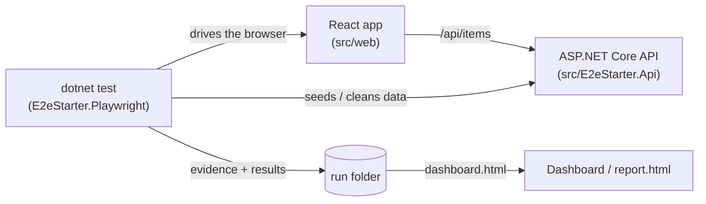

<div align="center">

# react-dotnet-playwright-e2e-starter

**A domain-agnostic starter for end-to-end testing a React app and an ASP.NET Core API with Playwright for .NET and xUnit v3, with a live dashboard and shareable report for the test runs.**

[](https://github.com/perisicnikola37/react-dotnet-playwright-e2e-starter/actions/workflows/ci.yml)
[](https://github.com/perisicnikola37/react-dotnet-playwright-e2e-starter/actions/workflows/e2e.yml)
[](https://github.com/perisicnikola37/react-dotnet-playwright-e2e-starter/actions/workflows/codeql.yml)
[](https://github.com/perisicnikola37/react-dotnet-playwright-e2e-starter/actions/workflows/publish.yml)


[](LICENSE)

[Packages](#-packages) · [How it works](#-how-it-works) · [Setup](#access-to-the-feeds) · [Test project](#1-test-project) · [Dashboard](#2-dashboard) · [React](#3-react-frontend) · [Configuration](#configuration) · [Releasing](#-releasing) · [Contributing](#-contributing)


<sub>Preview with dummy data: <a href="https://perisicnikola37.github.io/react-dotnet-playwright-e2e-starter/">open the live demo</a> or build it yourself with <code>node packages/dashboard/demo/build.mjs --site _site</code>.</sub>

</div>

---

## 📦 Packages

| Package | Registry | Add it to | What it does |
|---|---|---|---|
| `E2eStarter.Playwright` | NuGet | the **test project** (xUnit v3) | settings loader, `SuiteFixture` and `UiTestBase` with isolated contexts, traces and failure evidence |
| `@perisicnikola37/e2e-starter-dashboard` | npm | any CI / web host | `dashboard.html`: a single-file live dashboard and standalone report |
| `@perisicnikola37/e2e-starter-client` | npm | the **React frontend** | typed client for the sample Items API |

> [!NOTE]
> All packages live in GitHub Packages of `perisicnikola37` and are versioned together (tag `vX.Y.Z`).

## 🔄 How it works



1. The test project drives the React app with Playwright and prepares its data through the API.
2. Every test gets its own browser context and trace; failures save `screenshot.png`, `page.html`, `url.txt` and `trace.zip`.
3. The run folder holds `index.html` (a copy of `dashboard.html`) and `data.json`. Open it to see totals, failures grouped by cause, new vs still failing tests, a timeline and per-test evidence.

## Access to the feeds

GitHub Packages needs a token with `read:packages` (CI: `GITHUB_TOKEN`; local: a classic PAT), even for public repositories.

<details>
<summary><b>NuGet.config</b> (next to your solution)</summary>

```xml
<configuration>
  <packageSources>
    <add key="perisicnikola37" value="https://nuget.pkg.github.com/perisicnikola37/index.json" />
  </packageSources>
  <packageSourceCredentials>
    <perisicnikola37>
      <add key="Username" value="YOUR_GITHUB_USER" />
      <add key="ClearTextPassword" value="%GITHUB_PACKAGES_TOKEN%" />
    </perisicnikola37>
  </packageSourceCredentials>
</configuration>
```

</details>

<details>
<summary><b>.npmrc</b> (next to your <code>package.json</code>)</summary>

```
@perisicnikola37:registry=https://npm.pkg.github.com
//npm.pkg.github.com/:_authToken=${GITHUB_PACKAGES_TOKEN}
```

</details>

> [!WARNING]
> Never commit a literal token. Read it from an environment variable, as above.

## 1. Test project

`E2eStarter.Playwright`

```
dotnet add package E2eStarter.Playwright
```

> [!IMPORTANT]
> Requires **xUnit v3** on the **Microsoft.Testing.Platform** runner (`global.json`: `"test": { "runner": "Microsoft.Testing.Platform" }`), and `<OutputType>Exe</OutputType>` in the test project.

```csharp
[CollectionDefinition(UiTestBase.CollectionName)]
public sealed class BrowserCollection : ICollectionFixture<SuiteFixture>;

[Trait(TestCategories.Key, TestCategories.Smoke)]
public sealed class AppLoadsTests(SuiteFixture suite) : UiTestBase(suite)
{
    [Fact]
    public async Task The_items_page_loads_with_its_heading()
    {
        var items = await new ItemsPage(Page).OpenAsync();
        (await items.HeadingTextAsync()).ShouldBe("Items");
    }
}
```

> [!TIP]
> Page objects own the locators; tests contain intent and assertions only. Prefer role / label, then `data-testid`, then CSS.

<details>
<summary><b>Contract: what a failed test leaves behind</b></summary>

| File | Written by | Notes |
|---|---|---|
| `screenshot.png` | `UiTestBase` | full page, taken on failure |
| `page.html` | `UiTestBase` | captured DOM |
| `url.txt` | `UiTestBase` | URL at the time of failure |
| `trace.zip` | `UiTestBase` | Playwright trace (`Artifacts:Trace`); open with `playwright show-trace` |

</details>

## 2. Dashboard

`@perisicnikola37/e2e-starter-dashboard`

```
npm install @perisicnikola37/e2e-starter-dashboard
```

The package ships one self-contained file, `dist/dashboard.html`. Put it next to your run data as `index.html`, or embed the data for a standalone report by replacing `<script id="report-data" type="application/json">null</script>` with the run as JSON.

<details>
<summary><b>Contract: <code>data.json</code></b></summary>

```jsonc
{
  "title": "My app · UI tests",
  "runId": "20261023143248",
  "previousRunId": "20261010090000",     // optional: enables "new failure" / "still failing"
  "environment": "staging",
  "baseUrl": "https://staging.example.test",
  "startedAt": "2026-10-23T14:32:48Z",
  "elapsedMs": 13000,
  "tests": [{
    "name": "My.Namespace.ItemsTests.Blank_name_is_rejected",
    "categories": ["Smoke"],
    "status": "failed",                  // passed | failed | skipped
    "previous": "passed",                // status in the previous run
    "durationMs": 3200,
    "error": "…", "stack": "…", "url": "…",
    "steps": ["Open /items", "Click 'Add item'"], "failedStep": 1,
    "console": ["[error] …"], "screenshot": "evidence/blank-name.png"
  }]
}
```

</details>

Keyboard: `/` search · `j` / `k` step through failures.

## 3. React frontend

`@perisicnikola37/e2e-starter-client`

```
npm install @perisicnikola37/e2e-starter-client
```

```tsx
import { createItemsClient } from "@perisicnikola37/e2e-starter-client";

const client = createItemsClient();           // same origin; pass { baseUrl } otherwise
const items = await client.list();
await client.create("Review the test plan");
```

## Quick start

Requirements: .NET 10 SDK, Node.js 22+, PowerShell (`pwsh`) for the browser install.

```bash
npm ci
dotnet build E2eStarter.sln
pwsh tests/E2eStarter.E2E/bin/Debug/net10.0/playwright.ps1 install chromium
scripts/run-e2e.sh                      # start API + web, run all tests, clean up
scripts/run-e2e.sh --browser chrome     # use the system Chrome
dotnet test --project tests/E2eStarter.E2E --filter-trait "Category=Smoke"
dotnet test --project tests/E2eStarter.Api.Tests
```

The script refuses to start if ports `5080` / `5180` are already in use.

## Configuration

Settings come from `appsettings.json`, overridable with `E2E_`-prefixed environment variables (`__` as the separator).

| Variable | Default | Meaning |
|---|---|---|
| `E2E_BaseUrl` | `http://localhost:5180` | web app under test |
| `E2E_ApiBaseUrl` | `http://localhost:5080` | API used for data setup |
| `E2E_Browser__Name` | `chromium` | `chromium`, `chrome`, `firefox`, `webkit` |

## Project structure

```text
src/
  E2eStarter.Api/          sample minimal API (in-memory items + /health)
  E2eStarter.Playwright/   reusable test infrastructure (NuGet)
  web/                     sample React + Vite app
packages/
  api-client/              typed npm client
  dashboard/               dashboard.html + demo builder (npm)
tests/
  E2eStarter.E2E/          page objects + Smoke/Regression tests
  E2eStarter.Api.Tests/    API integration tests
scripts/run-e2e.sh         start apps, run tests, clean up
.github/workflows/         ci, e2e, codeql, commitlint, publish, pages
```

## 🚀 Releasing

1. Bump `<Version>` in `Directory.Build.props` and `version` in both `packages/*/package.json` (they must match).
2. Update `CHANGELOG.md`, merge, then push the tag: `git tag vX.Y.Z && git push origin vX.Y.Z`.

The **Publish** workflow verifies that the tag matches every version, publishes the NuGet and npm packages and creates the GitHub Release. The **Preview** workflow redeploys the demo to GitHub Pages on every change to the dashboard.

## 🤝 Contributing

See [CONTRIBUTING.md](CONTRIBUTING.md), [CODE_OF_CONDUCT.md](CODE_OF_CONDUCT.md) and [SECURITY.md](SECURITY.md). Commits and PR titles follow Conventional Commits; pull requests are squash-merged.

## License

[MIT](LICENSE)
